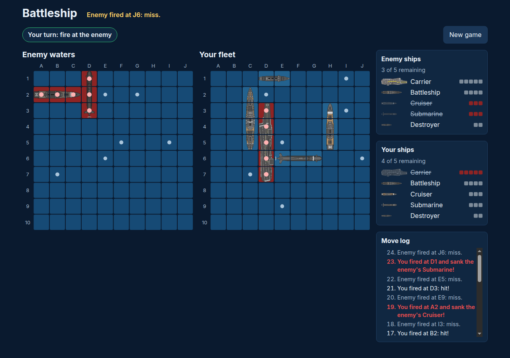
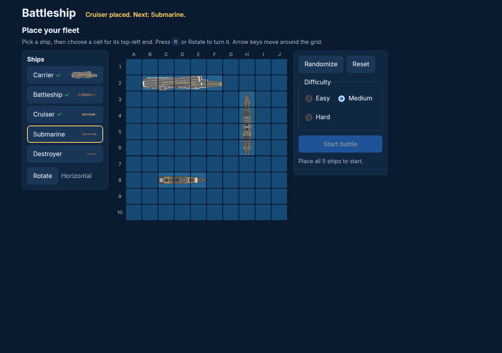
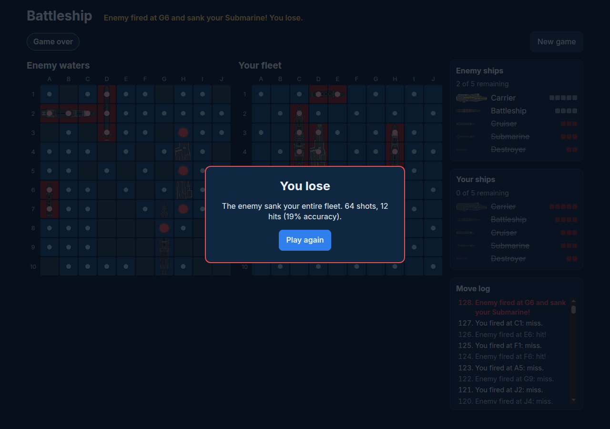

# Battleship

[](https://github.com/felipepojo/battleship/actions/workflows/ci.yml)
[](https://github.com/felipepojo/battleship/actions/workflows/deploy.yml)

Classic Battleship in the browser: one player against an AI opponent with three difficulty levels.
It is a fully static app built with Vite, React and TypeScript. It has no backend and no tracking.

**Live demo:** https://felipepojo.github.io/battleship/



| Fleet placement                                      | Game over                                          |
| ---------------------------------------------------- | -------------------------------------------------- |
|  |  |

## How to play

1. **Place your fleet** on the 10x10 grid: Carrier (5), Battleship (4), Cruiser (3), Submarine (3) and
   Destroyer (2). Pick a ship, use **Rotate** to switch between horizontal and vertical, then click a
   cell. You can also use **Randomize** to place every ship at once. Ships may touch but not overlap.
2. **Choose a difficulty** (Easy, Medium or Hard) and press **Start battle**.
3. **Fire** by clicking a cell in _Enemy waters_. The board is keyboard accessible too: use the arrow keys,
   then Enter or Space to fire. Turns alternate after every shot, whether it hits or misses.
4. The first side to sink the whole enemy fleet wins. Press **Play again** to start over.

## Run locally

Requires Node.js 20.19+ (CI uses the version in [`.nvmrc`](.nvmrc)).

```sh
npm ci
npm run dev        # http://localhost:5173/battleship/
```

## Scripts

| Command             | Description                                          |
| ------------------- | ---------------------------------------------------- |
| `npm run dev`       | Start the Vite dev server                            |
| `npm run build`     | Type-check and build the static site into `dist/`    |
| `npm run preview`   | Serve the production build locally                   |
| `npm run lint`      | ESLint                                               |
| `npm run format`    | Format with Prettier (`format:check` to verify only) |
| `npm run typecheck` | `tsc -b` with no output                              |
| `npm test`          | Run the Vitest suite once (`test:watch` to watch)    |

## Architecture

The code is split into three layers. Dependencies point one way only: UI → AI → engine.

- **`src/engine/`**: a pure, immutable game engine with no React and no DOM. It covers board creation,
  placement validation, random fleet layout, firing, sink and win detection, turn flow, and a seedable RNG.
  Invalid moves return `{ ok: false, error }` instead of throwing. The `AIPlayer` interface lives in `ai.ts`.
- **`src/ai/`**: the AI opponents behind `createAI(difficulty, rng?)`. Each AI rebuilds its view of the board
  from the shots it has fired, so it never fires at the same cell twice or outside the board. Details are
  in [docs/ai.md](docs/ai.md).
- **`src/game/` + `src/components/`**: the React UI. The `useGame` hook drives the engine and schedules the
  AI's turn. Components render the placement screen, both boards, ship status, the move log and the
  game-over dialog.

## AI strategies

- **Easy (random):** fires at a uniformly random cell it has not shot yet. It has no memory of hits, so it
  needs about 95 shots on average to win.
- **Medium (hunt / target):** hunts on a single checkerboard colour, because every ship covers at least
  one cell of each colour. After a hit it targets the neighbouring cells and follows the line once two hits
  line up. It averages about 51 shots.
- **Hard (probability density):** for every remaining ship, it counts each placement that is still possible
  given the misses and sunk ships. Placements through unresolved hits get much more weight. It fires at the
  cell covered by the most weighted placements and averages about 45 shots.

## Testing

`npm test` runs Vitest with jsdom and React Testing Library:

- engine unit tests for placement, firing, sinking, turns and the RNG;
- AI tests, including a simulation of 500 seeded games per level. It checks that there are no duplicate or
  out-of-bounds shots, that every game ends, and that average shots go hard < medium < easy;
- UI tests that play full games against the real easy, medium and hard AIs.

Any `console.error` or `console.warn` during a test fails it (see `src/test/setup.ts`).

CI ([`.github/workflows/ci.yml`](.github/workflows/ci.yml)) runs on every push and pull request. It runs
`npm ci` (with an npm cache), then lint, format check, typecheck, test and build, and fails on any error.

## Deployment

The site is deployed to GitHub Pages by [`.github/workflows/deploy.yml`](.github/workflows/deploy.yml) on
every push to `main`. You can also run it manually from the Actions tab. The workflow tests, builds and
uploads `dist/` with the official Pages actions. In the repository's Pages settings, the source must be
set to **GitHub Actions**.

GitHub Pages serves the site from `/battleship/`, so Vite's `base` defaults to `/battleship/` in
[`vite.config.ts`](vite.config.ts). A wrong base path is the usual cause of a blank page. To deploy to a
host that serves from the root, such as Vercel or Netlify, build with `BASE_PATH=/ npm run build`.

## Credits

Ship images come from the [Sea Warfare set](https://opengameart.org/content/sea-warfare-set-ships-and-more) by Lowder2 on OpenGameArt, released under [CC0](https://creativecommons.org/publicdomain/zero/1.0/) (public domain). They are cropped and rotated copies in `src/assets/ships/`.

## License

[MIT](LICENSE) © Felipe Pojo
